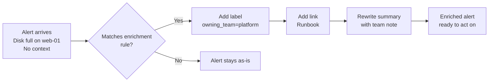
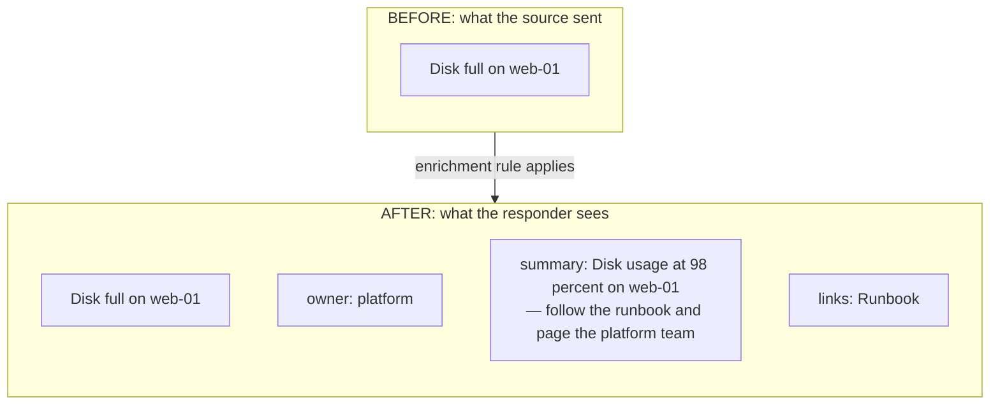

It is late, and an alert fires. It says one thing: **"Disk full."**

No hostname. No runbook. No owner. Just the bare minimum, and now someone on-call has to open three tabs, find the runbook, look up which team owns the service, and figure out what to do next. The clock is ticking the whole time.

This is the part of on-call that never shows up in a dashboard: the gap between knowing something is wrong and knowing what to do about it. It is a small gap on a good night. On a bad night, it is the difference between a five-minute fix and a thirty-minute scramble.

OpsiMate has a feature that closes that gap. It is called **Enrichments**, and it is worth five minutes of your time.

## What Enrichments Do

An enrichment is a rule that runs when an alert arrives. When the alert matches a pattern you define, the rule attaches extra information to it, so that by the time anyone opens the alert, the context is already there.

You decide what gets attached. It can be:

- **Labels** to categorize the alert, like the owning team or the environment
- **Links** to runbooks, dashboards, or the source of the alert
- **A rewritten summary** that adds context to whatever the source sent

The rule runs automatically. Nobody has to click anything or fill anything in. The next time an alert is fetched, it simply arrives with more context than it had before.

*Figure 1: How an enrichment rule turns a raw alert into an enriched one.*

## A Real Example

Let us walk through what this looks like in practice.

### Enriching a Disk Full Alert

An alert comes in from a monitoring source. It says:

> **Disk full on web-01**

That is it. Nothing else.

Now let us say you have created an enrichment rule that matches any alert whose name contains "disk full." The rule does three things:

1. Adds a label called `owning_team` with the value of the alert's `team` tag
2. Attaches a link to the disk-full runbook
3. Rewrites the summary to append a note about paging the platform team

The next time that alert is fetched, it looks like this:

> **Disk full on web-01**  
> Owner: platform  
> Summary: Disk usage at 98 percent on web-01 — follow the runbook and page the platform team  
> Links: Runbook

The alert is the same alert. Same source, same severity, same urgency. But the person who opens it now knows exactly what to do and who to talk to.

*Figure 2: The same alert, before and after the enrichment rule applies*.

### Known Issues, Without Silencing the Alert

Not every alert needs action right now.

Sometimes you know about an issue, you know it is being fixed, and you know the fix date. But you do not want to turn off the alert in its source. That hides the issue from everyone and might let a real problem slip through.

Here is a case I see often in teams.

Kafka starts sending alerts: **Unable to connect to Kafka**. The team already knows about it. The broker is being replaced next week. The issue is being worked on. But the alert fires a dozen times a day, and every time it does, someone has to figure out whether this is the known issue or a new one.

An enrichment rule can match that alert and add a note to the summary:

> **Unable to connect to Kafka** — Known issue. Broker replacement scheduled for 12/11/2026.

The alert is still visible. It still fires. It is still in the pipeline. But everyone who sees it now knows it is already being tracked, and the on-call engineer does not have to ask in Slack whether this one is the known issue or something new.

That is a small feature doing a real job. It is not changing the source. It is not silencing the alert. It is not editing the monitoring tool. It is adding context, so everyone sees the same thing.

## Who This Is For

Enrichments are useful for any team that runs on-call. But they are especially helpful for:

- **NOC teams** that triage a high volume of alerts from many sources
- **Small teams** where the same person handles the alert, finds the runbook, and pages the right people
- **Platform teams** that want a consistent view of alerts, no matter which monitoring tool sent them

The feature is also good at one specific problem: **normalizing alert noise across tools.** Different monitoring sources use different words for the same severity. One says `Disaster`. Another says `error`. Another says `P1`. OpsiMate already maps these onto a fixed scale, and an enrichment rule can make sure every alert lands on the same three levels, no matter which source it came from.

## Why It Works

Three design decisions make Enrichments different from the alert-routing rules you may already have used elsewhere:

- **Rules run at read time, not at ingestion.** The original alert source is not modified. You can add, change, or remove a rule at any time, and the next fetch reflects the change. That means experimenting is safe.
- **Rules apply in priority order.** When several rules match the same alert, the higher-priority rule wins on conflicting fields. Summary templates chain, so a lower-priority rule can append to what a higher-priority rule already wrote.
- **Rules can match on labels added by other rules.** This is how you build layered rules. One rule classifies an alert, and a second rule reacts to that classification. The result is a small rule engine, not a flat list of matchers.

## How to Set It Up

Setting up an enrichment takes about five minutes. The OpsiMate docs have a full step-by-step walkthrough with screenshots, a worked example, and reference sections for every field.

If you are running OpsiMate locally, or on a team instance, you can start with the disk full example above and adapt it to your own alerts.

[Read the Enrichments guide in the OpsiMate docs →](https://docs.opsimate.dev/docs/alerts/enrichments)

## Try It and Tell Us What You Think

Enrichments was built to solve a real problem: the small gap between an alert firing and someone knowing what to do about it. If you try it and it saves you a few minutes on the next incident, we would love to hear about it.

If you find a rule that works especially well for your setup, share it. If something is unclear in the docs, tell us. OpsiMate is a community project, and the people using it are the ones who make it better.

You can find us on [GitHub](https://github.com/OpsiMate/OpsiMate) and in the OpsiMate community Slack.